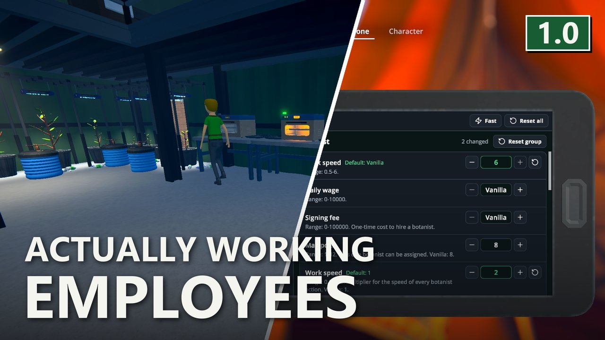
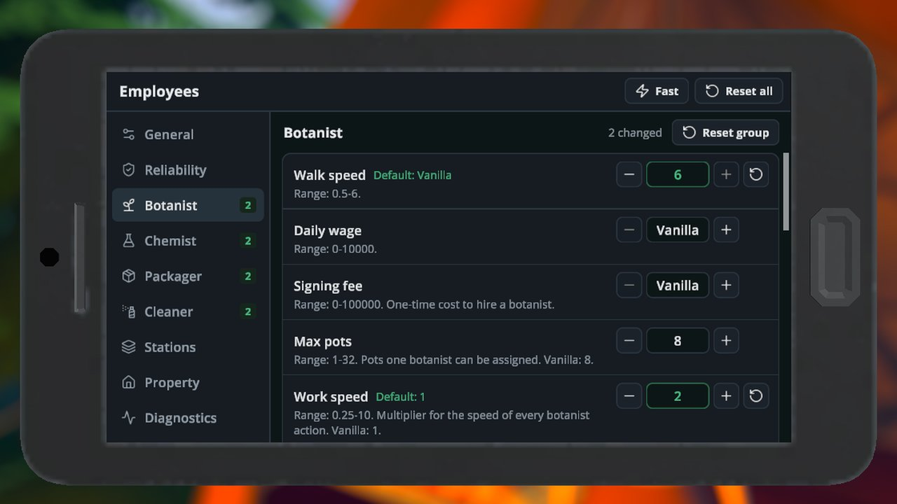
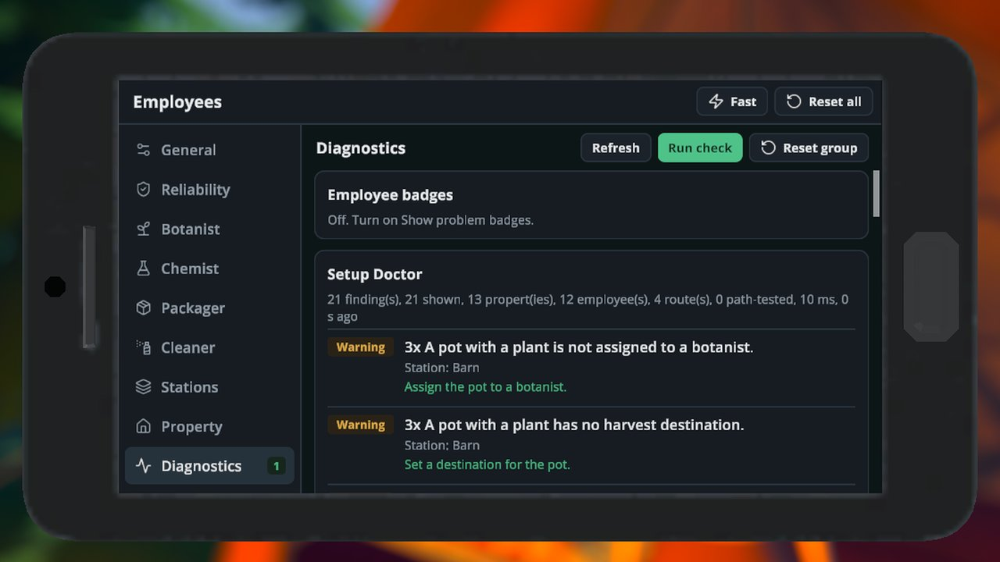

# Actually Working Employees - Employees That Keep Working

> 🛟 **Need help or found a bug?** Get support at [support.doodesch.de/actuallyworkingemployees](https://support.doodesch.de/actuallyworkingemployees).

> Botanists, chemists, handlers and cleaners that stop mid-job, walk in circles or stand idle without a reason? This mod fixes them on the host and puts every employee setting in a phone app. Every setting starts at the vanilla value. Built on [S1API](https://github.com/ifBars/S1API) and [Sideload](https://thunderstore.io/c/schedule-i/p/DooDesch/Sideload/).

## Features

Fixes for all four employee roles. They run on the host and stay on while you change settings:

- **No more endless walks.** An employee that loops a failed walk, or stands still while it should walk, is moved to its target.
- **Chemists keep going.** A chemist that fills a cauldron counts as working and is not sent to a new task. A chemist that sits without a task is reset, but a running station is never interrupted.
- **No leftover locks.** Stations and slots are freed when an employee stops working or is fired, and before the night is skipped.
- **No lost items.** Something an employee still carries goes back to its source slot when the task is cut short.
- **Real reasons.** Idle chemists and cleaners say which station or bin holds them back.
- **Cheaper path checks.** Whether a station can be reached is remembered for a few seconds instead of checked every tick.

On top of that:

- **Every employee balance setting.** Walk speed, wages, signing fees, assignment limits and the time of each action, for botanists, chemists, handlers and cleaners. All at the vanilla value until you change them.
- **Fast preset.** One button doubles the work speed and raises the walk speed of all four roles. Wages and limits stay as they are.
- **Handler routes.** Wait for a worthwhile load before a trip, and pick the fullest, emptiest or nearest route first.
- **Botanists and sprinklers.** The botanist can leave pots alone that a sprinkler watered recently.
- **Station and growth speed.** Speed multipliers for plants, mushrooms, drying racks, cauldrons, lab ovens and mixing stations.
- **More employees per property.** Properties can hold more employees than idle spots, and the employee limit can be changed.
- **Walk through each other.** Employees can ignore each other and furniture colliders while walking.
- **Diagnostics.** Problem badges, a Setup Doctor and idle time tracking show what holds an employee back. All three are off by default.

## The phone app

Open **Employees** on your phone. The groups are on the left, the settings of the selected group on the right.

- Switches, steppers and typed values change a setting. The value is saved about a second later.
- A setting that differs from the default shows its default and a reset button.
- **Fast** applies the Fast preset after a confirmation. **Reset all** sets everything back to the defaults.
- **Use vanilla balance** (General) makes every balance setting act like the base game while it is on. The fixes stay active.
- The Diagnostics group has the Setup Doctor's **Run check** button, the problem badges and the idle time list.

The app needs Sideload. Without it the settings still work through the file below.

## Configuration

Settings are saved in `UserData/ActuallyWorkingEmployees.cfg`, one `[AWE_<Group>]` section per group. On the first start the mod takes over the values it finds in `MelonPreferences.cfg`. Edit the file while the game is closed, or use the app.

In walk speed, daily wage and signing fee, `-1` means the game's own value.

The release build has no dev console commands. They exist only in Debug builds.

### General

Section `[AWE_General]`. Switches that apply to the whole mod.

| Key | Default | What it does |
|---|---|---|
| `UseVanillaBalance` | Off | Every balance setting acts as in the base game while on. Fixes stay active. |
| `DisableEmployeeCollision` | Off | Employees no longer block each other while walking. |
| `DisableFurnitureCollision` | Off | Employees walk through furniture colliders on their path. |
| `VerboseLogging` | Off | Writes detailed lines to the log: option changes and feature start-up. |

### Reliability

Section `[AWE_Reliability]`. The fixes. Each one has an on/off switch and, where it makes sense, its timing.

| Key | Default | What it does |
|---|---|---|
| `FixPartialWalkLoop` | On | Counts a partial walk far from the target as a failure so the employee warps instead of looping. |
| `PathFailuresBeforeWarp` | 5 | Failed walks in a row before the employee is moved to the target. |
| `FixStandstill` | On | Moves an employee that stands still while it should be walking. |
| `StandstillSeconds` | 12 | Seconds an employee may stand still before it is reset. |
| `StandstillRadius` | 0.5 | Distance in meters an employee must move to count as not standing still. |
| `StandstillAttempts` | 2 | Resets tried before the employee's current task is released. |
| `FixChemistWorkInProgress` | On | Counts cauldrons as work in progress so a chemist does not wait forever. |
| `ChemistIdleTimeout` | 5 | Seconds a chemist may idle before its task is reset. A running station is never interrupted. |
| `FixLockLeak` | On | Frees station locks when an employee stops working or is fired. |
| `FixStuckInventoryItem` | On | Puts an item an employee still carries back to its source slot when the task ends. |
| `ClearReasons` | On | Idle employees say the real reason instead of "nothing to do". |
| `CacheReachability` | On | Remembers whether a station can be reached instead of re-checking every tick. |
| `ReachabilityCacheSeconds` | 10 | Seconds a cached reachability result is kept. |
| `SleepSafeRelease` | On | Frees employees and their stations before the night is skipped. |

### Botanist

Section `[AWE_Botanist]`. Pots, mushroom beds, drying racks and spawn stations. Seconds are per action.

| Key | Default | What it does |
|---|---|---|
| `WalkSpeed` | -1 | Walk speed. |
| `DailyWage` | -1 | Daily wage. |
| `SigningFee` | -1 | One-time cost to hire a botanist. |
| `MaxPots` | 8 | Pots one botanist can be assigned. |
| `WorkSpeed` | 1 | Multiplier for the speed of every botanist action. |
| `SoilTime` | 10 | Seconds to add soil to a pot. |
| `WaterTime` | 10 | Seconds to water a pot or mushroom bed. |
| `AdditiveTime` | 10 | Seconds to apply an additive to a pot. |
| `SowTime` | 15 | Seconds to sow a seed in a pot. |
| `HarvestTimePerUnit` | 1 | Seconds to harvest one unit from a pot. |
| `DryingRackTime` | 1 | Seconds to start a drying rack. |
| `MushroomBedTime` | 15 | Seconds to apply spawn to a mushroom bed. |
| `MushroomHarvestTimePerUnit` | 1 | Seconds to harvest one unit from a mushroom bed. |
| `SpawnStationTime` | 6 | Seconds to use a spawn station. |
| `CriticalWaterLevel` | 0.2 | Moisture below which a pot counts as urgent and is watered first. |
| `WaterLevel` | 0.3 | Moisture below which a pot is watered. |
| `UseSprinklers` | Off | The botanist skips pots whose sprinkler sprayed within the last 3 game hours. |

### Chemist

Section `[AWE_Chemist]`. Lab ovens, chemistry stations, mixing stations and cauldrons.

| Key | Default | What it does |
|---|---|---|
| `WalkSpeed` | -1 | Walk speed. |
| `DailyWage` | -1 | Daily wage. |
| `SigningFee` | -1 | One-time cost to hire a chemist. |
| `MaxStations` | 4 | Stations one chemist can be assigned. |
| `WorkSpeed` | 1 | Multiplier for the speed of every chemist action. |
| `LabOvenStartTime` | 5 | Seconds to load a lab oven. |
| `LabOvenFinishTime` | 10 | Seconds to empty a lab oven. |
| `ChemistryStationTime` | 20 | Total seconds to set up a chemistry station. |
| `MixingStationTime` | 1 | Seconds per ingredient at a mixing station. |
| `CauldronTime` | 15 | Seconds to start a cauldron. |

### Packager

Section `[AWE_Packager]`. The handler, listed as Packager in the file. Packaging stations, brick presses, transit routes and batch handling.

| Key | Default | What it does |
|---|---|---|
| `WalkSpeed` | -1 | Walk speed. |
| `DailyWage` | -1 | Daily wage. |
| `SigningFee` | -1 | One-time cost to hire a packager. |
| `MaxStations` | 3 | Stations one packager can be assigned. |
| `MaxRoutes` | 5 | Routes one packager can be assigned. |
| `WorkSpeed` | 1 | Multiplier for the speed of every packager action. |
| `PackagingSpeed` | 1 | Multiplier for packaging speed. |
| `PackagingStationTime` | 5 | Seconds to package at a packaging station. |
| `BrickPressTime` | 15 | Seconds to press a brick. |
| `MoveItemTime` | 0.5 | Seconds to hand over an item. |
| `BatchHandling` | Off | The packager skips a route until enough items are ready. Vanilla: off, one trip per item. |
| `BatchThreshold` | 10 | Items that must be ready before the packager starts a trip. 1 acts as vanilla. |
| `BatchTimeoutSeconds` | 60 | Seconds the packager waits for a full load before going anyway. |
| `BatchFullStackOnly` | Off | Batch handling counts only full stacks. |
| `RoutePriorityMode` | Vanilla | Which ready route the packager picks. Fullest: biggest load. Emptiest: destination with most room. NearestFirst: closest source. Vanilla: the game's order. |
| `RouteDiagnostics` | Off | Logs why a route was skipped. |
| `RouteWarnIntervalSeconds` | 30 | Minimum seconds between repeated route warnings. |
| `LogBatchActivity` | On | Writes batch waits and departures to the log. |
| `ShowBatchWaitingReason` | On | Shows why a packager is waiting for a batch. |

### Cleaner

Section `[AWE_Cleaner]`. Trash pickup, bagging and disposal.

| Key | Default | What it does |
|---|---|---|
| `WalkSpeed` | -1 | Walk speed. |
| `DailyWage` | -1 | Daily wage. |
| `SigningFee` | -1 | One-time cost to hire a cleaner. |
| `MaxBins` | 6 | Bins one cleaner can be assigned. |
| `WorkSpeed` | 1 | Multiplier for the speed of every cleaner action. |
| `TrashPickupTime` | 0.9 | Seconds to pick up one piece of trash. |
| `BagTime` | 3 | Seconds to bag the trash of a bin. |
| `DisposeTime` | 1.2 | Seconds to dispose of a trash bag. |
| `EmptyGrabberTime` | 1 | Multiplier for the time to empty the trash grabber; 2 takes twice as long. |

### Stations

Section `[AWE_Stations]`. Station and growth speed. Needs `EnableStationSpeed` on.

| Key | Default | What it does |
|---|---|---|
| `EnableStationSpeed` | Off | Turns on the station and growth speed settings below. |
| `PlantGrowthSpeed` | 1 | Speed multiplier for plant growth. |
| `MushroomGrowthSpeed` | 1 | Speed multiplier for mushroom growth. |
| `DryingRackSpeed` | 1 | Speed multiplier for drying racks. |
| `CauldronSpeed` | 1 | Speed multiplier for cauldron cooking. |
| `LabOvenSpeed` | 1 | Speed multiplier for lab ovens. |
| `MixingStationSpeed` | 1 | Speed multiplier for mixing stations. |
| `MixingStationMaxBatch` | 10 | Largest batch a mixing station takes. |
| `ShowStationSpeedWarning` | On | Shows a hint on the Stations page that saved mixes and running stations keep their old time after a speed change. |

### Property

Section `[AWE_Property]`. Employees per property.

| Key | Default | What it does |
|---|---|---|
| `EnableEmployeeCapacityOverride` | Off | Uses the employee limit below for every property. Co-op guests without this mod get errors for employees beyond the property's idle spots. |
| `EmployeeCapacity` | 0 | Employees a property can hold while the override is on. 0 = each property's own value. |
| `ShareIdlePoints` | On | Extra employees share idle spots when there are fewer spots than employees. |
| `EmployeeCapacityLossGuard` | On | Refuses a lower capacity while a property has more employees than that. |

### Diagnostics

Section `[AWE_Diagnostics]`. Tools that show what holds an employee back. All of them are off by default.

| Key | Default | What it does |
|---|---|---|
| `ShowProblemBadges` | Off | Lists a problem badge for each employee in the Employees panel of the Diagnostics page. Host only. |
| `EnableSetupDoctor` | Off | Adds a Run check button to the Diagnostics page. It lists problems in the employee setup. |
| `DoctorCheckReachability` | Off | The Setup Doctor tests whether each route can be walked. |
| `DoctorMaxFindings` | 25 | Most findings the Setup Doctor lists. |
| `EnableAnalytics` | Off | Records how long each employee idles and why, shown on the Diagnostics page. |
| `AnalyticsIntervalSeconds` | 5 | Seconds between idle samples. |
| `LogFixActions` | On | Writes a log line for each warp, release and unstick. |
| `ShowCoopLockNotice` | On | Shows a notice at the top of the app on a co-op client when the host controls settings. |

## Co-op

Only the host (or a single-player game) changes values. A guest who has the mod sees the host's values in the app, locked, with a short notice. The notice can be turned off with `ShowCoopLockNotice`.

The employee logic runs on the host, so guests do not need the mod for the fixes and settings to take effect. A guest without the mod gets errors for employees beyond a property's idle spots when `EnableEmployeeCapacityOverride` is on.

These settings stay local on every machine: `VerboseLogging`, `LogFixActions`, `ShowBatchWaitingReason`, `ShowStationSpeedWarning` and `ShowCoopLockNotice`.

The host publishes its changed values in the Steam lobby data. Only values that differ from the default are sent.

## Compatibility

Actually Working Employees is not compatible with Harder Working Employees. Remove `HarderWorkingEmployees.dll` from your `Mods` folder. If both are loaded, the game log shows a warning.

## Screenshots

## Requirements

| Mod | Version |
|---|---|
| [MelonLoader](https://melonwiki.xyz/) | 0.7.3 or newer |
| [S1API](https://thunderstore.io/c/schedule-i/p/ifBars/S1API_Forked/) | 3.2.1 or newer |
| [Sideload](https://thunderstore.io/c/schedule-i/p/DooDesch/Sideload/) | 1.36.3 or newer |

## Installation

### Mod manager

Install with a Thunderstore mod manager (r2modman or Gale) from the Schedule I community. MelonLoader, S1API and Sideload are installed with it.

### Manual

1. Install **MelonLoader 0.7.3** for Schedule I.
2. Install **S1API** and **Sideload** as their pages describe.
3. Remove `HarderWorkingEmployees.dll` if it is in your `Mods` folder.
4. Put **`ActuallyWorkingEmployees.dll`** into your Schedule I `Mods` folder.

## Community

Join the DooDesch Mods Discord: update pings, polls on what comes next, and playtests of new mods.

## Credits

Built by DooDesch on [S1API](https://github.com/ifBars/S1API) by ifBars.

## License

MIT, see [LICENSE.md](LICENSE.md).

This mod is written with help from generative AI tools (Anthropic Claude, OpenAI Codex).

If you have fun with it, a like on the [Thunderstore page](https://thunderstore.io/c/schedule-i/p/DooDesch/ActuallyWorkingEmployees/) really helps other people find it (thumbs up next to Download, you need to be logged in) - ty either way, and lemme know if anything breaks or you've got ideas
